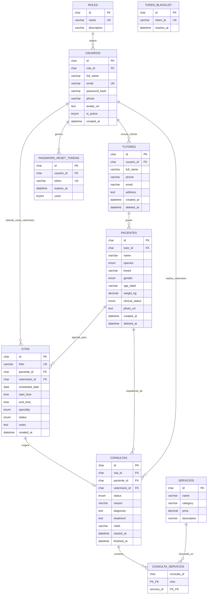

# Bobby VetCare

## Estudiantes
- Edwin Alexis Esperanza Chavez
- ~~Felix Eliel Olivera Jimenez~~

---

## Descripción del Proyecto
**Bobby VetCare** es una aplicación web frontend y backend para la **gestión clínica veterinaria** (portal público para tutores, control de pacientes, agenda de citas, consultas médicas, reporte clínico y administración de usuarios), desarrollada con React 19, TypeScript y Tailwind CSS en el frontend, y Spring Boot 3 con Spring Security (JWT) y MySQL en el backend.

### Ventanas y Módulos del Sistema
- **Portal de Pacientes (`/` o `/portal`):** Landing pública para tutores con consulta de seguimiento clínico mediante folio.
- **Acceso Staff (`/login`):** Inicio de sesión para personal clínico (`ADMIN`, `VETERINARIO`) y clientes (`CLIENTE`).
- **Dashboard (`/dashboard`):** Resumen operativo con métricas clínicas y accesos rápidos.
- **Gestión de Pacientes (`/patients`):** Directorio clínico con filtros, búsqueda y exportación.
- **Perfil del Paciente (`/patients/:id`):** Expediente detallado con historial, citas y edición de datos.
- **Agenda de Citas (`/citas`):** Programación, filtrado por estado y seguimiento de citas.
- **Consultas Médicas (`/consultas`):** Registro y gestión de consultas veterinarias.
- **Reporte de Consulta (`/consultas/:id/reporte`):** Vista clínica para documentar hallazgos, diagnóstico, tratamiento y resumen del expediente en pantalla.
- **Gestión de Usuarios (`/usuarios`):** Administración de cuentas y roles del sistema.
- **Perfil de Usuario (`/perfil`):** Información de la sesión activa.

---

## Tecnologías Utilizadas

- **Frontend:** React 19, TypeScript, Vite, Tailwind CSS v4
- **Navegación y Estado:** React Router DOM v7, TanStack Query v5
- **Formularios y Validación:** React Hook Form, Zod, validación visual en tiempo real
- **UI y Experiencia:** Lucide React, Framer Motion, Three.js, SweetAlert2
- **Backend:** Java 21 / 25, Spring Boot 3, Spring Data JPA / Hibernate, Spring Security con JWT
- **Base de Datos:** MySQL 8.0+ (InnoDB, UTF-8 mb4, restricciones FK, índices únicos)
- **Comunicaciones y Automatización:**
  - **Correo electrónico:** `JavaMailSender` integrado con servidor Postfix local en el VPS (sin servicios SMTP de terceros)
  - **WhatsApp API:** Twilio WhatsApp REST API con envíos asíncronos (`@Async`) y recordatorios programados (`@Scheduled`)
  - **SMS API:** Twilio SMS REST API integrado para confirmaciones, cancelaciones y reprogramaciones
  - **Automatizaciones de Recordatorio:** Notificaciones automáticas disparadas **a 24 horas** y **a 2 horas** de la cita médica
- **Infraestructura y Despliegue:** Hostinger VPS (Ubuntu Linux), Nginx, systemd, SSL gratuito con Let's Encrypt / Certbot, Docker

---

## Enlaces del Proyecto

| Recurso | Enlace / URL |
| :--- | :--- |
| **Diseño en Figma** | [Prototipo Navegable en Figma](https://www.figma.com/design/YXihT06njml4nVc5ZWtTG5/Bobby-VetCare?node-id=0-1&t=bN1qV1zUc5FatE6m-1) |
| **Tablero de GitHub Projects** | [Tablero de Tareas Público en GitHub Projects](https://github.com/devalex534dps-rgb/bobby-Vet-app/projects) |
| **Repositorio en GitHub** | [https://github.com/devalex534dps-rgb/bobby-Vet-app](https://github.com/devalex534dps-rgb/bobby-Vet-app) |
| **Sitio Web en Producción (HTTPS)** | [https://veterinariabobby.tech](https://veterinariabobby.tech) |
| **URL Base de la API (Producción)** | `https://veterinariabobby.tech/api/v1` |

---

## Credenciales de Acceso (Usuarios de Prueba)

El sistema cuenta con tres niveles de usuario (`ADMIN`, `VETERINARIO`, `CLIENTE`). Las contraseñas cumplen con las políticas de seguridad mínimas: al menos 8 caracteres, una mayúscula, un número y un carácter especial.

### Usuario Administrador de Evaluación
> Utilice este usuario para ingresar y evaluar todas las funciones administrativas y operativas del sistema:
* **Correo:** `admin@bobbyvetcare.mx`
* **Contraseña:** `BobbyAdmin2026!`
* **Rol:** `ADMIN` (Acceso completo a usuarios, pacientes, citas, consultas y reportes)

### Otros Usuarios Principales por Rol
| Rol | Nombre | Correo Electrónico | Contraseña | Teléfono |
| :--- | :--- | :--- | :--- | :--- |
| **ADMIN** | Administrador Bobby | `admin@bobbyvetcare.mx` | `BobbyAdmin2026!` | `+525510000001` |
| **VETERINARIO** | Dr. Julián Rivera | `vet@bobbyvetcare.mx` | `BobbyVet2026!` | `+525510000002` |
| **VETERINARIO** | Dra. Sofía Mendoza | `sofia.mendoza@bobbyvetcare.mx` | `BobbyVet2026!` | `+525510000003` |
| **CLIENTE** | Carlos Ramírez | `cliente@bobbyvetcare.mx` | `BobbyClient2026!` | `+525510000005` |
| **CLIENTE** | María Fernanda López | `mafer.lopez@correo.mx` | `BobbyClient2026!` | `+525510000006` |

### Folios de Prueba para Consulta Pública (`/portal` o `/`)
Para consultar el expediente clínico sin iniciar sesión como staff:
- `BVC-2026-0001`
- `BOB-2026-001`

### Listado Completo de Usuarios Precargados (Seed Data)
| # | Rol | Nombre Completo | Correo (`email`) | Contraseña | Teléfono |
| :---: | :--- | :--- | :--- | :--- | :--- |
| 1 | `ADMIN` | Administrador Bobby | `admin@bobbyvetcare.mx` | `BobbyAdmin2026!` | `+525510000001` |
| 2 | `VETERINARIO` | Dr. Julián Rivera | `vet@bobbyvetcare.mx` | `BobbyVet2026!` | `+525510000002` |
| 3 | `VETERINARIO` | Dra. Sofía Mendoza | `sofia.mendoza@bobbyvetcare.mx` | `BobbyVet2026!` | `+525510000003` |
| 4 | `VETERINARIO` | Dr. Alejandro Castro | `alejandro.castro@bobbyvetcare.mx` | `BobbyVet2026!` | `+525510000004` |
| 5 | `CLIENTE` | Carlos Ramírez | `cliente@bobbyvetcare.mx` | `BobbyClient2026!` | `+525510000005` |
| 6 | `CLIENTE` | María Fernanda López | `mafer.lopez@correo.mx` | `BobbyClient2026!` | `+525510000006` |
| 7 | `CLIENTE` | Luis Hernández | `luis.hernandez@correo.mx` | `BobbyClient2026!` | `+525510000007` |
| 8 | `CLIENTE` | Ana Paula Torres | `ana.torres@correo.mx` | `BobbyClient2026!` | `+525510000008` |
| 9 | `CLIENTE` | Jorge Morales | `jorge.morales@correo.mx` | `BobbyClient2026!` | `+525510000009` |
| 10 | `CLIENTE` | Lucía Vargas | `lucia.vargas@correo.mx` | `BobbyClient2026!` | `+525510000010` |

---

## Diagrama Entidad-Relación (ER)

El modelo de datos cuenta con **10 tablas relacionales**, incluyendo una relación de muchos a muchos (**N:M**) entre `consultas` y `servicios` a través de la tabla de unión `consulta_servicios`.



### Características del Modelo de Base de Datos
- **Identificadores universales (`UUID / CHAR(36)`):** Garantizan unicidad global sin colisión de IDs secuenciales.
- **Relación N:M:** `consultas` y `servicios` conectados mediante la tabla pivote `consulta_servicios`.
- **Soft Delete:** Tablas críticas como `pacientes` y `tutores` manejan borrado lógico mediante `deleted_at`.
- **Seguridad de Tokens:** `token_blacklist` para revocación instantánea en `/auth/logout` y `password_reset_tokens` para recuperación segura de contraseñas.
- **Trazabilidad y Folios:** Citas con folios alfanuméricos únicos (ej. `BVC-2026-XXXXXX`) indexados para consulta pública en portal.

---

## Instalación y Ejecución Local

### Prerrequisitos
- **Node.js:** v20.x o superior con `npm`
- **Java JDK:** 21 o superior (compatible con Java 25)
- **Maven:** 3.9+ (o utilizar el wrapper `./mvnw` / `.\mvnw.cmd`)
- **MySQL:** 8.0+ en ejecución local
- **Docker** *(opcional)*: Para pruebas SMTP locales con MailHog

---

### 1. Clonar el Repositorio
```bash
git clone https://github.com/devalex534dps-rgb/bobby-Vet-app.git
cd bobby-Vet-app
```

---

### 2. Configurar la Base de Datos (MySQL)

1. Inicie sesión en su servidor MySQL:
   ```bash
   mysql -u root -p
   ```
2. Ejecute los scripts de esquema y datos de prueba ubicados en la carpeta `database/`:
   ```sql
   SOURCE database/02-schema.sql;
   SOURCE database/03-seed-data.sql;
   ```
   *Esto creará la base de datos `bobby_vetcare` con las 10 tablas relacionadas y más de 10 registros por tabla.*

---

### 3. Configurar y Ejecutar el Backend (Spring Boot)

1. Navegue al directorio `backend`:
   ```bash
   cd backend
   ```
2. Revise el archivo `src/main/resources/application.properties` (o copie desde `application.properties.example`) y configure las credenciales de su base de datos local y puertos:
   ```properties
   spring.datasource.url=jdbc:mysql://localhost:3306/bobby_vetcare?useSSL=false&allowPublicKeyRetrieval=true&serverTimezone=America/Mexico_City
   spring.datasource.username=root
   spring.datasource.password=SU_CONTRASEÑA_MYSQL
   
   # Servidor de Correo (Postfix local o MailHog para desarrollo)
   spring.mail.host=localhost
   spring.mail.port=1025
   
   # Twilio API (Opcional para desarrollo local)
   TWILIO_ACCOUNT_SID=
   TWILIO_AUTH_TOKEN=
   TWILIO_WHATSAPP_NUMBER=
   TWILIO_PHONE_NUMBER=
   ```
3. Compile y ejecute la aplicación Spring Boot:
   ```bash
   # En Windows:
   .\mvnw.cmd spring-boot:run

   # En Linux / macOS:
   ./mvnw spring-boot:run
   ```
4. La API REST estará activa en: `http://localhost:8080/api/v1`

---

### 4. Configurar y Ejecutar el Frontend (React + Vite)

Navegue al directorio `frontend`:
```bash
cd ../frontend
```

```bash
# 1. Instalar dependencias
npm install

# 2. Iniciar servidor de desarrollo
npm run dev

# 3. Compilar para producción
npm run build
```

La aplicación estará disponible en `http://localhost:5173`.

---

## Automatizaciones y Mensajería (WhatsApp, SMS y Correo)

1. **Correo Electrónico (Postfix local en VPS):**
   - Configurado en el VPS propio con Postfix, registros SPF y DKIM, consumido en Spring Boot con `JavaMailSender`.
   - Se disparan correos automáticos asíncronos (`@Async`) al crear citas y al ejecutar recordatorios.
2. **WhatsApp API (Twilio) & SMS:**
   - Envío asíncrono con formato E.164 (+52 para números de México).
   - Confirmación inmediata al agendar cita médica.
   - Notificación de reprogramación y aviso de cancelación.
3. **Automatizaciones Programadas (`@Scheduled`):**
   - **Recordatorio a 24 horas:** El sistema evalúa citas confirmadas dentro de la ventana de 24 horas y envía el mensaje de WhatsApp y correo con los detalles de la consulta del día siguiente.
   - **Recordatorio a 2 horas:** Recordatorio prioritario con mensaje de urgencia indicando el horario exacto y recomendación de presentarse 10 minutos antes en clínica.
   - **Control de Duplicados:** Registro en memoria concurrente para evitar notificaciones duplicadas en ejecuciones periódicas del scheduler.
