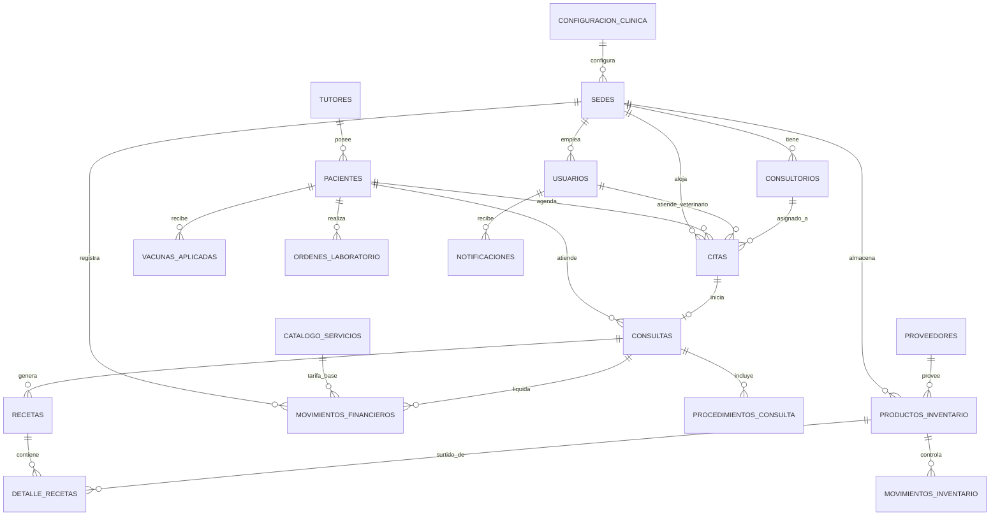

# Definición de Estructura de Base de Datos — Bobby VetCare

> **Documento:** `01-definicion-estructura-bd.md`  
> **Propósito:** Definir el modelo relacional de base de datos que soportará el backend de **Bobby VetCare**, alineado con todas las vistas, entidades, flujos clínicos y operaciones administrativas implementadas en el frontend (`src/pages/*` y `src/components/*`).

---

## 1. Contexto de la Aplicación

**Bobby VetCare** es una plataforma web de gestión clínica y administrativa para clínicas veterinarias (con soporte multi-sede). El frontend está construido en React + TypeScript y ya contempla la preparación para conectarse a una API REST/GraphQL en los siguientes módulos funcionales:

| Módulo Frontend | Ruta | Responsabilidad Principal |
| :--- | :--- | :--- |
| **Autenticación** | `/login` | Acceso del personal clínico y administrativo mediante credenciales y rol. |
| **Dashboard** | `/dashboard` | Resumen ejecutivo de citas del día, ingresos, ocupación y consultas recientes. |
| **Pacientes y Expediente** | `/patients`, `/patients/:id` | Registro de mascotas, tutores, microchip, estado clínico, vacunas, recetas y estudios de laboratorio. |
| **Agenda y Citas** | `/citas` | Calendario (Día / Semana / Mes), asignación por veterinario, especialidad y box/quirófano, y solicitudes pendientes. |
| **Consultas Activas** | `/consultas` | Atención clínica en curso: signos vitales, motivo, diagnóstico, checklist de procedimientos, prescripciones y pase a caja. |
| **Inventario y Farmacia** | `/inventario` | Control de medicamentos, vacunas, material quirúrgico y nutrición clínica, lotes, caducidades, PVP/costo y proveedores. |
| **Finanzas y Facturación** | `/finanzas` | Registro de ingresos y gastos operativos por sede, métodos de pago y flujo financiero. |
| **Reportes** | `/reportes` | Métricas analíticas por rango de fechas y sede (ingresos, consultas, inventario, desempeño). |
| **Centro de Notificaciones** | `/notificaciones` | Alertas categorizadas (clínicas, citas, farmacia, finanzas, sistema), estado de lectura y acciones rápidas. |
| **Búsqueda Global** | `/buscar` | Búsqueda transversal de pacientes, tutores, citas y productos. |
| **Configuración** | `/configuracion` | Datos fiscales de la clínica, branding, usuarios/permisos, horarios/guardias, catálogo de tarifas y preferencias de alertas. |

---

## 2. Contexto de la Base de Datos

- **Motor seleccionado:** **MySQL 8.0+** (con motor transaccional `InnoDB`, codificación `utf8mb4_unicode_ci`, soporte nativo de `JSON`, restricciones `CHECK`, `ENUM` en columna y `DEFAULT (UUID())`).
- **Convenciones de diseño:**
  - **Nombres de tablas en español** para alinear el esquema directamente con el dominio clínico y administrativo de la plataforma.
  - **Claves primarias (`id`):** `CHAR(36)` con `DEFAULT (UUID())`.
  - **Auditoría estándar:** Todas las tablas principales incluyen `created_at` y `updated_at` (`DATETIME(3)` con `DEFAULT CURRENT_TIMESTAMP(3)` y `ON UPDATE CURRENT_TIMESTAMP(3)`), además de `deleted_at` (soft-delete) en entidades críticas (`pacientes`, `tutores`, `usuarios`, `productos_inventario`).
  - **Multi-sede (`branch_id`):** Permite filtrar citas, finanzas, inventario y reportes por sucursal (*Clínica Central*, *Sede Norte*, etc.) o consolidar todas las sedes.
  - **Integridad referencial:** Claves foráneas explícitas con políticas `ON DELETE RESTRICT` para historial clínico/financiero y `ON DELETE CASCADE` únicamente para detalles dependientes (`procedimientos_consulta`, `detalle_recetas`).
  - **Moneda y tiempo:** Los montos se almacenan en `DECIMAL(12, 2)` acompañados de la moneda base configurada (`USD`, `EUR`, `MXN`) y las fechas en `DATETIME(3)`.

---

## 3. Diagrama Entidad-Relación (Vista General)

---

## 4. Definición Detallada de Tablas por Dominio

### 4.1. Configuración, Sedes y Usuarios

#### `configuracion_clinica`
Almacena la configuración global visible en `/configuracion`.
- `id` (`UUID`, PK)
- `clinic_name` (`VARCHAR(150)`, NOT NULL) — Ej. *"Bobby VetCare Clinic & Spa"*
- `tax_id` (`VARCHAR(50)`, NOT NULL) — NIF / RFC / CIF
- `license_number` (`VARCHAR(80)`) — Ej. *"REIAC-VET-2024-8841B"*
- `phone` (`VARCHAR(30)`)
- `email` (`VARCHAR(120)`)
- `address` (`TEXT`)
- `timezone` (`VARCHAR(60)`, DEFAULT `'Europe/Madrid'`)
- `base_currency` (`VARCHAR(10)`, DEFAULT `'USD'`)
- `primary_color` (`CHAR(7)`, DEFAULT `'#024594'`)
- `accent_color` (`CHAR(7)`, DEFAULT `'#00639a'`)
- `logo_url` (`TEXT`)
- `schedule_config` (`JSONB`) — Horarios de apertura/cierre entre semana, sábados y guardias
- `updated_at` (`TIMESTAMPTZ`)

#### `sedes`
- `id` (`UUID`, PK)
- `code` (`VARCHAR(30)`, UNIQUE, NOT NULL) — Ej. `'central'`, `'norte'`
- `name` (`VARCHAR(120)`, NOT NULL) — Ej. *"Clínica Central"*, *"Sede Norte"*
- `address` (`TEXT`)
- `phone` (`VARCHAR(30)`)
- `is_active` (`BOOLEAN`, DEFAULT `true`)
- `created_at` (`TIMESTAMPTZ`)

#### `usuarios`
- `id` (`UUID`, PK)
- `branch_id` (`UUID`, FK -> `sedes.id`)
- `full_name` (`VARCHAR(120)`, NOT NULL) — Ej. *"Dr. Julian Rivera"*, *"Dra. Eleanor Vance"*
- `email` (`VARCHAR(150)`, UNIQUE, NOT NULL)
- `password_hash` (`TEXT`, NOT NULL)
- `role` (`ENUM('admin', 'veterinarian', 'technician', 'receptionist')`, NOT NULL)
- `specialty` (`VARCHAR(80)`)
- `avatar_url` (`TEXT`)
- `is_active` (`BOOLEAN`, DEFAULT `true`)
- `last_login_at` (`TIMESTAMPTZ`)
- `created_at` (`TIMESTAMPTZ`)
- `deleted_at` (`TIMESTAMPTZ`, NULL)

---

### 4.2. Tutores y Pacientes

#### `tutores`
- `id` (`UUID`, PK)
- `full_name` (`VARCHAR(120)`, NOT NULL)
- `phone` (`VARCHAR(30)`, NOT NULL)
- `email` (`VARCHAR(150)`)
- `address` (`TEXT`)
- `document_id` (`VARCHAR(40)`)
- `notes` (`TEXT`)
- `created_at` (`TIMESTAMPTZ`)
- `updated_at` (`TIMESTAMPTZ`)
- `deleted_at` (`TIMESTAMPTZ`, NULL)

#### `pacientes`
Mapea directamente con `Patient` en `src/components/patients/types.ts`.
- `id` (`UUID`, PK)
- `owner_id` (`UUID`, FK -> `tutores.id`, NOT NULL)
- `branch_id` (`UUID`, FK -> `sedes.id`)
- `name` (`VARCHAR(80)`, NOT NULL)
- `species` (`ENUM('Canino', 'Felino')`, NOT NULL)
- `breed` (`VARCHAR(80)`, NOT NULL)
- `gender` (`ENUM('Macho', 'Hembra')`)
- `birth_date` (`DATE`) — Permite calcular la edad dinámicamente
- `age_label` (`VARCHAR(40)`) — Respaldo textual si no se conoce fecha exacta
- `weight_kg` (`NUMERIC(6, 2)`)
- `chip_id` (`VARCHAR(60)`, UNIQUE)
- `photo_url` (`TEXT`)
- `clinical_status` (`ENUM('Al día', 'En tratamiento', 'En seguimiento', 'Vacuna pendiente', 'En recuperación')`, DEFAULT `'Al día'`)
- `allergies` (`TEXT`)
- `chronic_conditions` (`TEXT`)
- `created_at` (`TIMESTAMPTZ`)
- `updated_at` (`TIMESTAMPTZ`)
- `deleted_at` (`TIMESTAMPTZ`, NULL)

---

### 4.3. Agenda, Consultorios y Citas

#### `consultorios`
- `id` (`UUID`, PK)
- `branch_id` (`UUID`, FK -> `sedes.id`, NOT NULL)
- `name` (`VARCHAR(60)`, NOT NULL) — Ej. *"Box 1"*, *"Box 2"*, *"Quirófano A"*, *"Quirófano B"*, *"Estética"*
- `room_type` (`ENUM('consultation', 'surgery', 'grooming', 'emergency')`, NOT NULL)
- `is_active` (`BOOLEAN`, DEFAULT `true`)

#### `citas`
Mapea con `CalendarEvent` y `PendingAppointment` en `src/pages/Appointments.tsx`.
- `id` (`UUID`, PK)
- `branch_id` (`UUID`, FK -> `sedes.id`, NOT NULL)
- `patient_id` (`UUID`, FK -> `pacientes.id`, NOT NULL)
- `vet_id` (`UUID`, FK -> `usuarios.id`, NOT NULL)
- `room_id` (`UUID`, FK -> `consultorios.id`)
- `specialty` (`ENUM('general', 'vacuna', 'cirugia', 'estetica', 'guardia')`, NOT NULL)
- `status` (`ENUM('pending', 'confirmed', 'in_progress', 'completed', 'cancelled', 'no_show')`, DEFAULT `'confirmed'`)
- `scheduled_date` (`DATE`, NOT NULL)
- `start_time` (`TIME`, NOT NULL)
- `end_time` (`TIME`, NOT NULL)
- `source` (`ENUM('web', 'whatsapp', 'phone', 'reception')`, DEFAULT `'reception'`)
- `notes` (`TEXT`)
- `reminder_sent` (`BOOLEAN`, DEFAULT `false`)
- `created_at` (`TIMESTAMPTZ`)
- `updated_at` (`TIMESTAMPTZ`)

---

### 4.4. Módulo Clínico (Consultas, Vacunas y Laboratorio)

#### `consultas`
Soporta `src/pages/Consultations.tsx`.
- `id` (`UUID`, PK)
- `appointment_id` (`UUID`, FK -> `citas.id`, UNIQUE, NULL)
- `patient_id` (`UUID`, FK -> `pacientes.id`, NOT NULL)
- `vet_id` (`UUID`, FK -> `usuarios.id`, NOT NULL)
- `branch_id` (`UUID`, FK -> `sedes.id`, NOT NULL)
- `status` (`ENUM('active', 'completed', 'billed')`, DEFAULT `'active'`)
- `reason` (`TEXT`, NOT NULL) — Motivo de consulta
- `anamnesis` (`TEXT`)
- `diagnosis` (`TEXT`)
- `clinical_notes` (`TEXT`)
- `vitals` (`JSONB`) — `{ weight_kg, temperature_c, heart_rate_bpm, respiratory_rate_rpm, capillary_refill_sec }`
- `started_at` (`TIMESTAMPTZ`, DEFAULT `now()`)
- `finished_at` (`TIMESTAMPTZ`)

#### `procedimientos_consulta`
- `id` (`UUID`, PK)
- `consultation_id` (`UUID`, FK -> `consultas.id` ON DELETE CASCADE, NOT NULL)
- `title` (`VARCHAR(150)`, NOT NULL)
- `detail` (`TEXT`)
- `status` (`VARCHAR(40)`, DEFAULT `'Pendiente'`)
- `completed` (`BOOLEAN`, DEFAULT `false`)
- `completed_at` (`TIMESTAMPTZ`)

#### `recetas` y `detalle_recetas`
- `recetas`: `id` (`UUID`, PK), `consultation_id` (`UUID`, FK -> `consultas.id`), `patient_id` (`UUID`, FK -> `pacientes.id`), `vet_id` (`UUID`, FK -> `usuarios.id`), `instructions` (`TEXT`), `issued_at` (`TIMESTAMPTZ`).
- `detalle_recetas`: `id` (`UUID`, PK), `prescription_id` (`UUID`, FK -> `recetas.id` ON DELETE CASCADE), `inventory_item_id` (`UUID`, FK -> `productos_inventario.id`, NULL), `medication_name` (`VARCHAR(150)`, NOT NULL), `dosage` (`VARCHAR(80)`), `frequency` (`VARCHAR(80)`), `duration_days` (`INTEGER`).

#### `vacunas_aplicadas`
- `id` (`UUID`, PK)
- `patient_id` (`UUID`, FK -> `pacientes.id`, NOT NULL)
- `consultation_id` (`UUID`, FK -> `consultas.id`, NULL)
- `vaccine_name` (`VARCHAR(120)`, NOT NULL)
- `batch_number` (`VARCHAR(60)`)
- `applied_at` (`DATE`, NOT NULL)
- `next_due_date` (`DATE`)
- `administered_by` (`UUID`, FK -> `usuarios.id`)

#### `ordenes_laboratorio`
- `id` (`UUID`, PK)
- `patient_id` (`UUID`, FK -> `pacientes.id`, NOT NULL)
- `consultation_id` (`UUID`, FK -> `consultas.id`, NULL)
- `study_type` (`VARCHAR(120)`, NOT NULL)
- `status` (`ENUM('ordered', 'processing', 'results_ready', 'reviewed')`, DEFAULT `'ordered'`)
- `result_summary` (`TEXT`)
- `attachment_url` (`TEXT`)
- `requested_at` (`TIMESTAMPTZ`)
- `completed_at` (`TIMESTAMPTZ`)

---

### 4.5. Inventario, Farmacia y Proveedores

#### `proveedores`
- `id` (`UUID`, PK)
- `name` (`VARCHAR(120)`, NOT NULL) — Ej. *"Zoetis Animal Health"*, *"MSD Animal Health"*
- `contact_name` (`VARCHAR(120)`)
- `phone` (`VARCHAR(30)`)
- `email` (`VARCHAR(120)`)

#### `productos_inventario`
Mapea con `ProductRow` en `src/pages/Inventory.tsx`.
- `id` (`UUID`, PK)
- `branch_id` (`UUID`, FK -> `sedes.id`, NOT NULL)
- `supplier_id` (`UUID`, FK -> `proveedores.id`)
- `name` (`VARCHAR(150)`, NOT NULL)
- `active_ingredient` (`VARCHAR(150)`)
- `sku` (`VARCHAR(60)`, NOT NULL)
- `lot_number` (`VARCHAR(60)`)
- `category` (`ENUM('medicamentos', 'vacunas', 'quirurgico', 'nutricion')`, NOT NULL)
- `stock_current` (`INTEGER`, NOT NULL, DEFAULT `0`)
- `stock_min` (`INTEGER`, NOT NULL, DEFAULT `10`)
- `unit` (`VARCHAR(30)`, DEFAULT `'unidades'`)
- `expiry_date` (`DATE`)
- `cost_price` (`NUMERIC(12, 2)`, NOT NULL)
- `sale_price` (`NUMERIC(12, 2)`, NOT NULL) — PVP
- `created_at` (`TIMESTAMPTZ`)
- `updated_at` (`TIMESTAMPTZ`)
- `deleted_at` (`TIMESTAMPTZ`, NULL)

#### `movimientos_inventario`
- `id` (`UUID`, PK)
- `inventory_item_id` (`UUID`, FK -> `productos_inventario.id`, NOT NULL)
- `user_id` (`UUID`, FK -> `usuarios.id`)
- `movement_type` (`ENUM('purchase', 'sale', 'consultation_use', 'adjustment', 'expired')`, NOT NULL)
- `quantity_delta` (`INTEGER`, NOT NULL)
- `reference_id` (`UUID`) — ID de consulta o movimiento financiero
- `notes` (`TEXT`)
- `created_at` (`TIMESTAMPTZ`)

---

### 4.6. Catálogo de Tarifas y Finanzas

#### `catalogo_servicios`
- `id` (`UUID`, PK)
- `name` (`VARCHAR(120)`, NOT NULL)
- `specialty` (`ENUM('general', 'vacuna', 'cirugia', 'estetica', 'guardia')`)
- `base_price` (`NUMERIC(12, 2)`, NOT NULL)
- `tax_rate` (`NUMERIC(5, 2)`, DEFAULT `0.00`)
- `is_active` (`BOOLEAN`, DEFAULT `true`)

#### `movimientos_financieros`
Soporta `src/pages/Finances.tsx` y métricas de `src/pages/Reports.tsx`.
- `id` (`UUID`, PK)
- `branch_id` (`UUID`, FK -> `sedes.id`, NOT NULL)
- `consultation_id` (`UUID`, FK -> `consultas.id`, NULL)
- `owner_id` (`UUID`, FK -> `tutores.id`, NULL)
- `recorded_by` (`UUID`, FK -> `usuarios.id`, NOT NULL)
- `movement_type` (`ENUM('ingreso', 'gasto')`, NOT NULL)
- `category` (`VARCHAR(80)`, NOT NULL) — Consulta, Cirugía, Farmacia, Nómina, Proveedores
- `concept` (`VARCHAR(200)`, NOT NULL)
- `payment_method` (`ENUM('cash', 'card', 'transfer', 'insurance')`, DEFAULT `'card'`)
- `amount` (`NUMERIC(12, 2)`, NOT NULL, CHECK `amount > 0`)
- `currency` (`VARCHAR(10)`, DEFAULT `'USD'`)
- `occurred_at` (`TIMESTAMPTZ`, NOT NULL, DEFAULT `now()`)

---

### 4.7. Notificaciones

#### `notificaciones`
Mapea directamente con `NotificationItem` en `src/pages/Notifications.tsx`.
- `id` (`UUID`, PK)
- `user_id` (`UUID`, FK -> `usuarios.id`, NULL) — `NULL` si es notificación global de sede/clínica
- `branch_id` (`UUID`, FK -> `sedes.id`, NULL)
- `category` (`ENUM('clinical', 'appointments', 'pharmacy', 'finance', 'system')`, NOT NULL)
- `title` (`VARCHAR(160)`, NOT NULL)
- `badge` (`VARCHAR(40)`)
- `description` (`TEXT`, NOT NULL)
- `highlight_text` (`VARCHAR(120)`)
- `meta_left` (`VARCHAR(120)`)
- `meta_extra` (`VARCHAR(120)`)
- `action_label` (`VARCHAR(60)`)
- `action_route` (`VARCHAR(120)`)
- `is_urgent` (`BOOLEAN`, DEFAULT `false`)
- `is_read` (`BOOLEAN`, DEFAULT `false`)
- `created_at` (`TIMESTAMPTZ`, DEFAULT `now()`)

---

## 5. Índices Recomendados para Rendimiento

1. **Agenda y disponibilidad:** `CREATE INDEX idx_citas_sede_fecha ON citas (branch_id, scheduled_date, start_time);`
2. **Búsqueda de pacientes y raza:** `CREATE INDEX idx_pacientes_nombre_raza ON pacientes (deleted_at, name, breed);`
3. **Alertas de bajo stock y caducidad:** `CREATE INDEX idx_inventario_caducidad ON productos_inventario (branch_id, deleted_at, expiry_date);`
4. **Reportes financieros por período y sede:** `CREATE INDEX idx_finanzas_sede_fecha ON movimientos_financieros (branch_id, occurred_at);`
5. **Centro de notificaciones no leídas:** `CREATE INDEX idx_notificaciones_no_leidas ON notificaciones (user_id, is_read, created_at);`
